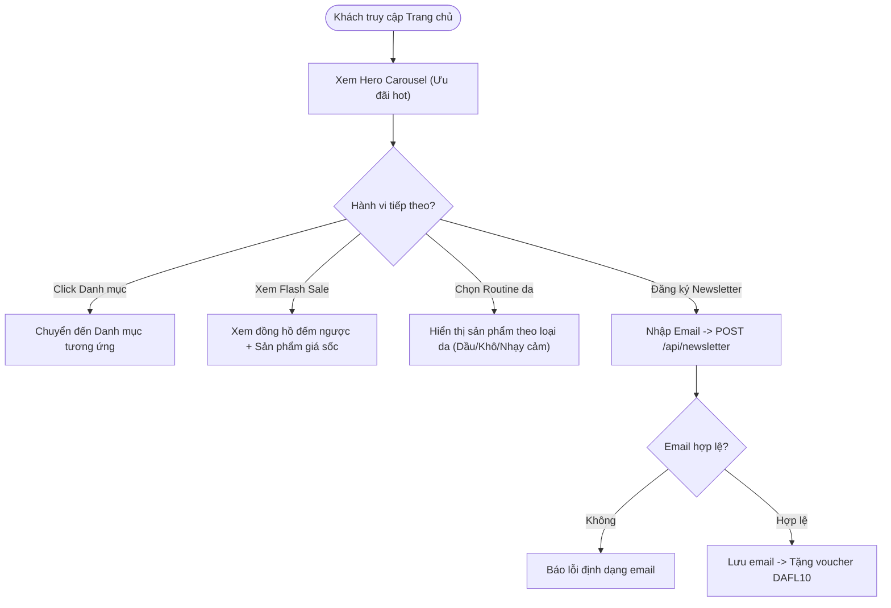
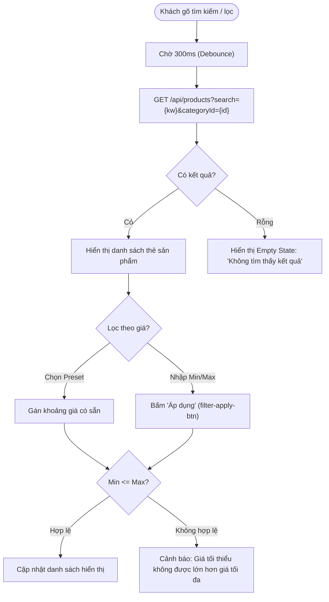
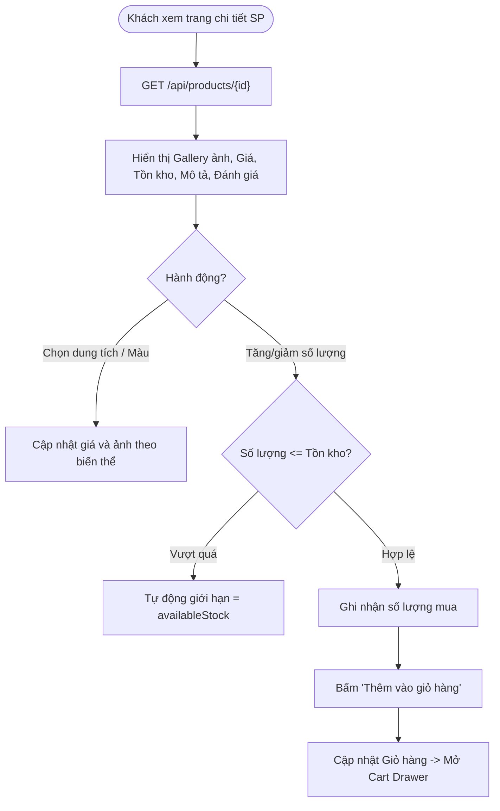
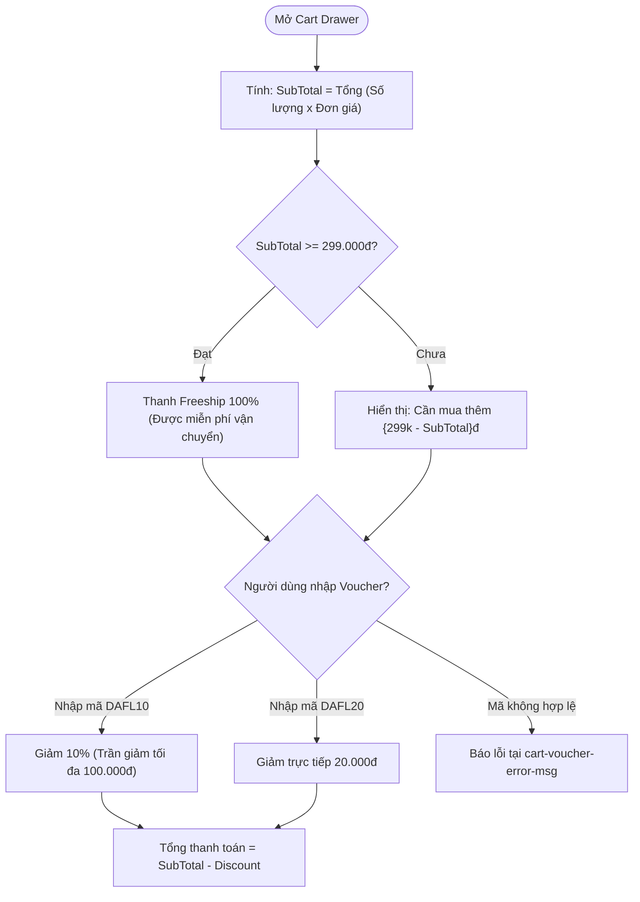
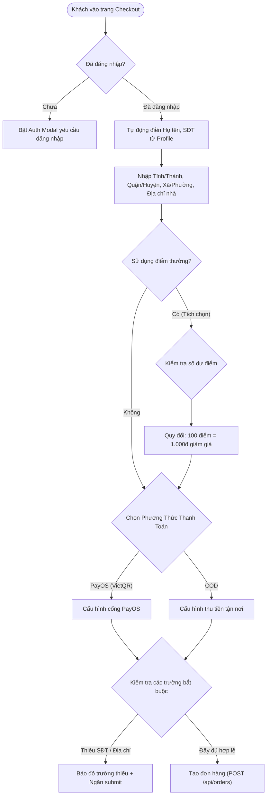
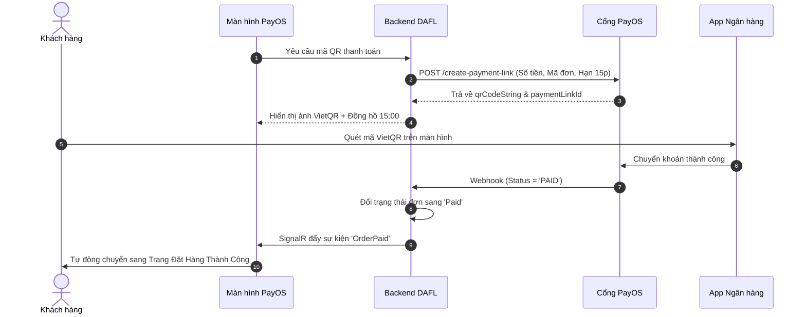
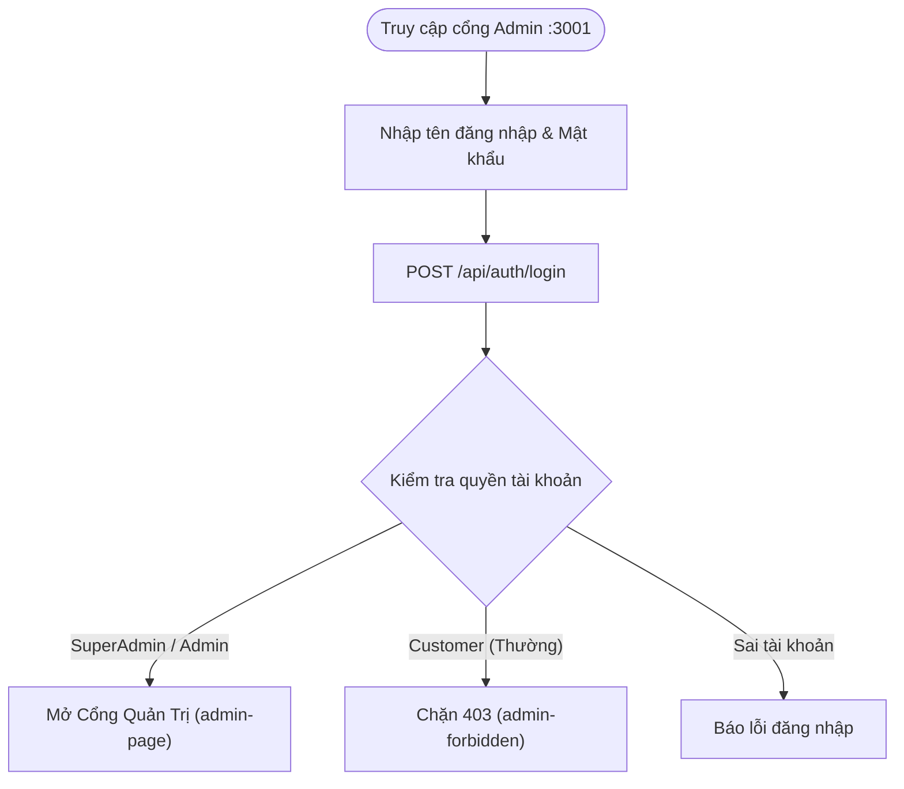
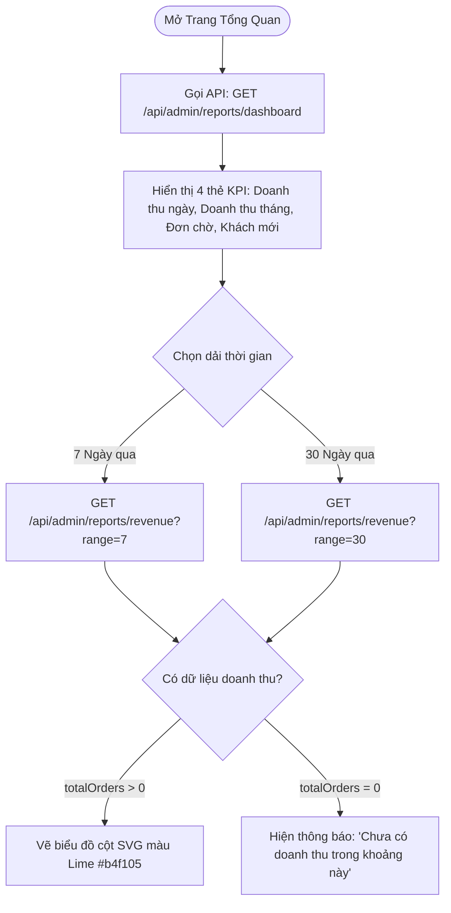
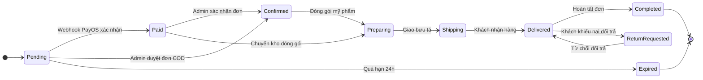
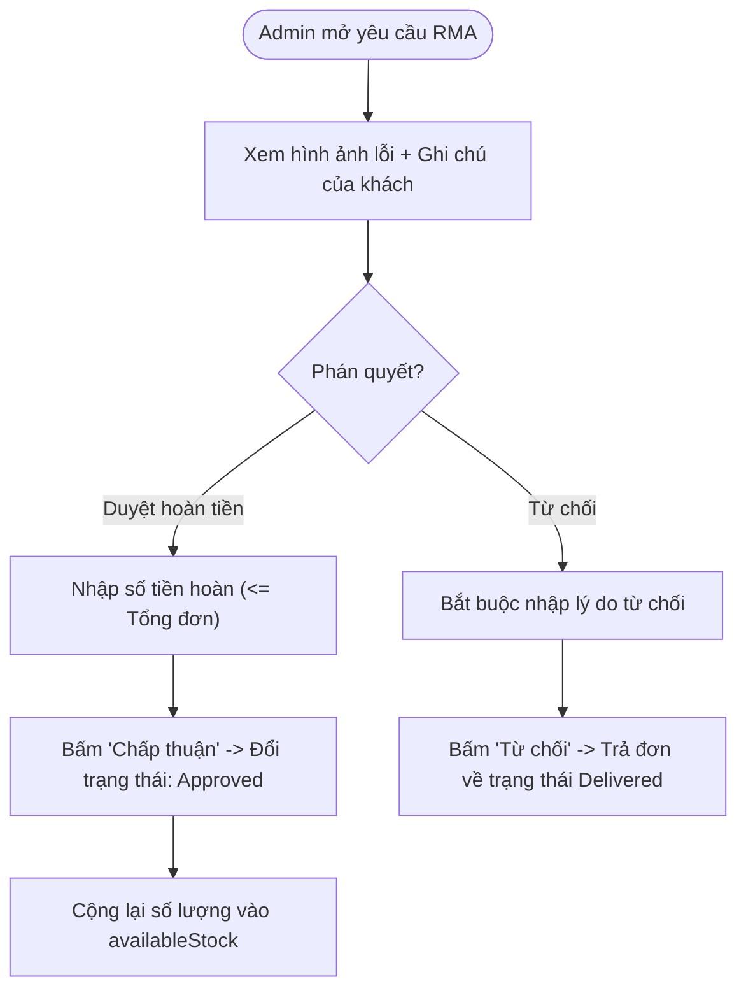

# TÀI LIỆU ĐẶC TẢ THIẾT KẾ GIAO DIỆN (UI/UX) VÀ LUỒNG NGHIỆP VỤ HỆ THỐNG
## Dự Án E-Commerce Mỹ Phẩm DAFL (Storefront :3000 & Admin Portal :3001)

> **Tài liệu chuẩn hóa dành cho:** Đồ án tốt nghiệp & Triển khai Frontend/Backend  
> **Phiên bản:** 1.0 — Chuẩn hóa tương thích 130 kịch bản kiểm thử tự động (Selenium POM + Quality Gate)  
> **Vai trò thực hiện:** Lead Business Analyst (BA) & Senior UI/UX Designer  

---

## MỤC LỤC

1. [TỔNG QUAN HỆ THỐNG & ĐỐI TƯỢNG NGƯỜI DÙNG](#1-tong-quan-he-thong--doi-tuong-nguoi-dung)
2. [HỆ THỐNG THIẾT KẾ (DESIGN SYSTEM & TOKENS)](#2-he-thong-thiet-ke-design-system--tokens)
3. [ĐẶC TẢ CHI TIẾT 10 TRANG & LUỒNG WEBSITE KHÁCH HÀNG (:3000)](#3-dac-ta-chi-tiet-10-trang--luong-website-khach-hang-3000)
   - [Trang 1: Trang Chủ (Home & Discovery)](#trang-1-trang-chu-home--discovery)
   - [Trang 2: Trang Danh Mục & Khám Phá (Catalog & Search)](#trang-2-trang-danh-muc--kham-pha-catalog--search)
   - [Trang 3: Trang Chi Tiết Sản Phẩm (Product Detail Page - PDP)](#trang-3-trang-chi-tiet-san-pham-product-detail-page---pdp)
   - [Trang 4: Ngăn Giỏ Hàng Thông Minh (Smart Cart Drawer)](#trang-4-ngan-gio-hang-thong-minh-smart-cart-drawer)
   - [Trang 5: Trang Đặt Hàng & Thanh Toán (One-Page Checkout)](#trang-5-trang-dat-hang--thanh-toan-one-page-checkout)
   - [Trang 6: Cổng Thanh Toán QR PayOS (PayOS Gateway View)](#trang-6-cong-thanh-toan-qr-payos-payos-gateway-view)
   - [Trang 7: Trang Xác Nhận Thanh Toán (Order Success View)](#trang-7-trang-xac-nhan-thanh-toan-order-success-view)
   - [Trang 8: Trang Lịch Sử Đơn Hàng (Customer Orders)](#trang-8-trang-lich-su-don-hang-customer-orders)
   - [Trang 9: Trung Tâm Hội Viên & Hồ Sơ (Profile & Loyalty Hub)](#trang-9-trung-tam-hoi-vien--ho-so-profile--loyalty-hub)
   - [Trang 10: Modal Xác Thực (Auth Modal: Login / Register)](#trang-10-modal-xac-thuc-auth-modal-login--register)
4. [ĐẶC TẢ CHI TIẾT 10 PHÂN HỆ & LUỒNG CỔNG QUẢN TRỊ ADMIN (:3001)](#4-dac-ta-chi-tiet-10-phan-he--luong-cong-quan-tri-admin-3001)
   - [Admin 1: Màn Hình Đăng Nhập Quản Trị (Admin Login)](#admin-1-man-hinh-dang-nhap-quan-tri-admin-login)
   - [Admin 2: Bảng Điều Khiển Tổng Quan (Dashboard & Analytics)](#admin-2-bang-dieu-khien-tong-quan-dashboard--analytics)
   - [Admin 3: Quản Lý Đơn Hàng (Order Management & Pipeline)](#admin-3-quan-ly-don-hang-order-management--pipeline)
   - [Admin 4: Drawer & Modal Chi Tiết Đơn Hàng (Order Detail Drawer)](#admin-4-drawer--modal-chi-tiet-don-hang-order-detail-drawer)
   - [Admin 5: Quản Lý Sản Phẩm (Product Catalog Management)](#admin-5-quan-ly-san-pham-product-catalog-management)
   - [Admin 6: Quản Lý Danh Mục (Category Management)](#admin-6-quan-ly-danh-muc-category-management)
   - [Admin 7: Quản Lý Khuyến Mãi & Voucher (Promotions & Coupons)](#admin-7-quan-ly-khuyen-mai--voucher-promotions--coupons)
   - [Admin 8: Quản Lý Khách Hàng (Customer 360 & CRM)](#admin-8-quan-ly-khach-hang-customer-360--crm)
   - [Admin 9: Cấu Hình Hạng Hội Viên (Loyalty Membership Matrix)](#admin-9-cau-hinh-hang-hoi-vien-loyalty-membership-matrix)
   - [Admin 10: Xử Lý Đổi Trả (RMA) & Nhật Ký Kiểm Toán (Audit Logs)](#admin-10-xu-ly-doi-tra-rma--nhat-ky-kiem-toan-audit-logs)
5. [MA TRẬN ĐỊNH DANH KIỂM THỬ TỰ ĐỘNG (AUTOMATION SELECTOR MATRIX)](#5-ma-tran-dinh-danh-kiem-thu-tu-dong-automation-selector-matrix)
6. [LỘ TRÌNH TRIỂN KHAI FRONTEND (DEVELOPMENT ROADMAP)](#6-lo-trinh-trien-khai-frontend-development-roadmap)

---

# 1. TỔNG QUAN HỆ THỐNG & ĐỐI TƯỢNG NGƯỜI DÙNG

### 1.1. Bối cảnh dự án
Hệ thống thương mại điện tử **DAFL** là nền tảng bán lẻ mỹ phẩm, chăm sóc da (Skincare) và sắc đẹp chính hãng. Hệ thống tích hợp:
- **Client Web (`localhost:3000`):** Trải nghiệm mua sắm hiện đại, tìm kiếm thông minh, giỏ hàng kéo trượt, thanh toán VietQR tự động qua cổng PayOS, chương trình tích điểm hội viên đa tầng (Loyalty Tier).
- **Admin Portal (`localhost:3001`):** Cổng điều hành nội bộ theo kiến trúc Spark Admin, thực thi máy trạng thái đơn hàng (Order State Machine), kiểm soát tồn kho, thiết lập khuyến mãi và duyệt đổi trả hàng (RMA).
- **Hệ thống Kiểm thử tự động:** Bộ kiểm thử Selenium Page Object Model gồm 130 test case (102 web + 28 admin) gắn liền với Quality Gate trong CI/CD pipeline.

### 1.2. Chân dung người dùng (User Personas)
*   **Persona 1: Khách hàng mua sắm (Shopper):** Cần thông tin bảng thành phần minh bạch, chứng nhận da liễu, theo dõi hành trình đơn hàng và thanh toán nhanh không rườm rà.
*   **Persona 2: Quản trị viên cửa hàng (Store Operator / Super Admin):** Cần xử lý nhanh danh sách đơn chờ duyệt, cập nhật trạng thái đơn hàng chuẩn xác, theo dõi biểu đồ doanh thu theo thời gian thực và quản lý khuyến mãi chống thất thoát ngân sách.

---

# 2. HỆ THỐNG THIẾT KẾ (DESIGN SYSTEM & TOKENS)

### 2.1. Bảng màu (Color Palette Tokens)

```text
[Primary Brand]      #9E2A2B  (Rose Velvet - Tinh tế, sang trọng, thúc đẩy chuyển đổi)
[Secondary Brand]    #2D6A4F  (Botanical Emerald - Đại diện cho mỹ phẩm thiên nhiên, lành tính)
[Accent Gold]        #D4AF37  (Royal Gold - Phù hiệu khách hàng VIP, điểm tích lũy)
[Admin Slate]        #0F172A  (Slate Dark - Sidebar admin chống mỏi mắt)
[Admin Lime Accent]  #B4F105  (Spark Lime - Điểm nhấn biểu đồ doanh thu SVG)
[Surface Light]      #FAF9F6  (Pearl Alabaster - Nền web dịu mắt, tôn hình ảnh sản phẩm)
```

### 2.2. Quy chuẩn Typography
*   **Font chữ nhận diện & Tiêu đề:** `Playfair Display` (Serif quý phái, thanh lịch).
*   **Font chữ giao diện & Nội dung:** `Plus Jakarta Sans` / `Inter` (Sans-serif chuẩn công thái học số).
*   **Thang kích thước:** H1: 36px/700 | H2: 28px/600 | H3: 20px/600 | Body: 15px/400 | Caption: 12px/500.

---

# 3. ĐẶC TẢ CHI TIẾT 10 TRANG & LUỒNG WEBSITE KHÁCH HÀNG (:3000)

---

### Trang 1: Trang Chủ (Home & Discovery)

#### A. Sơ đồ Luồng Nghiệp Vụ Trang Chủ


#### B. Khung Giao Diện & Bố Cục (Wireframe)
```text
+-----------------------------------------------------------------------------------+
| [TOPBAR]: ✨ Miễn phí vận chuyển cho đơn từ 299.000đ | Hotline: 1900-DAFL         |
+-----------------------------------------------------------------------------------+
| [LOGO DAFL]      [ 🔍 Tìm serum, kem dưỡng, son môi... ]      [Theme] [Hội viên]  |
|                  (Gợi ý: B5 Serum, Son bóng, Retinol)          [♡ Ưa thích] [🛒(2)]|
+-----------------------------------------------------------------------------------+
| [HERO CAROUSEL]: Banner chuyển động tự động 5s, slogan nghệ thuật, nút "Khám phá" |
| [ < Prev (hero-prev-btn) ]                                [ Next (hero-next-btn) ]|
+-----------------------------------------------------------------------------------+
| [DANH MỤC ICON TRÒN]: (Son môi) (Chăm sóc da) (Trang điểm) (Nước hoa) (Dưỡng thể) |
+-----------------------------------------------------------------------------------+
| ⚡ FLASH SALE HÔM NAY | Kết thúc trong [ 02 : 45 : 12 ]            [Xem tất cả >] |
| +----------------+ +----------------+ +----------------+ +----------------+     |
| | [Card SP 1]    | | [Card SP 2]    | | [Card SP 3]    | | [Card SP 4]    |     |
| | Đã bán 85%     | | Đã bán 60%     | | Đã bán 95%     | | Đã bán 40%     |     |
| +----------------+ +----------------+ +----------------+ +----------------+     |
+-----------------------------------------------------------------------------------+
| 🌿 THƯƠNG HIỆU NỔI BẬT: [Logo Sulwhasoo] [Logo La Roche-Posay] [Logo Innisfree]...|
+-----------------------------------------------------------------------------------+
| [NEWSLETTER]: Nhận cẩm nang Skincare & Mã giảm 10% [ Ô nhập email ] [ Đăng ký ]   |
+-----------------------------------------------------------------------------------+
```

#### C. Quy tắc nghiệp vụ & Selectors
*   **Flash Sale Timer:** Đếm ngược từng giây đến 00:00:00. Khi hết giờ, tự động tải lại danh sách deal mới.
*   **Selectors:** `brand-logo`, `hero-carousel`, `hero-prev-btn`, `hero-next-btn`, `category-icon-row`, `newsletter-input`, `newsletter-submit-btn`.

---

### Trang 2: Trang Danh Mục & Khám Phá (Catalog & Search)

#### A. Sơ đồ Luồng Nghiệp Vụ Lọc & Tìm Kiếm


#### B. Quy tắc nghiệp vụ & Selectors
*   **Presets giá:** `Dưới 200k`, `200k - 500k`, `Trên 500k`.
*   **Selectors:** `header-search-input`, `price-presets`, `price-preset-0`, `filter-apply-btn`, `product-card-{id}`.

---

### Trang 3: Trang Chi Tiết Sản Phẩm (Product Detail Page - PDP)

#### A. Sơ đồ Luồng Nghiệp Vụ Chi Tiết Sản Phẩm


#### B. Quy tắc nghiệp vụ & Selectors
*   **Chặn số lượng âm:** Giá trị tối thiểu luôn là $1$.
*   **Bảng thành phần (Full INCI):** Trình bày dạng danh sách có phân loại mức độ an toàn (Cosmetic Safety Index).
*   **Selectors:** `product-detail-name`, `product-detail-price`, `product-detail-stock`, `product-detail-add-to-cart-btn`, `product-detail-qty-input`.

---

### Trang 4: Ngăn Giỏ Hàng Thông Minh (Smart Cart Drawer)

#### A. Sơ đồ Luồng Nghiệp Vụ Giỏ Hàng & Voucher


#### B. Quy tắc nghiệp vụ & Selectors
*   **Ngưỡng Freeship:** $299.000đ$.
*   **Công thức tính Voucher DAFL10:** $\text{Discount} = \min\left(\text{SubTotal} \times 10\%, 100.000đ\right)$.
*   **Selectors:** `cart-drawer`, `cart-drawer-close-btn`, `cart-voucher-input`, `cart-voucher-apply`, `cart-voucher-discount`, `cart-voucher-error-msg`, `cart-checkout-btn`.

---

### Trang 5: Trang Đặt Hàng & Thanh Toán (One-Page Checkout)

#### A. Sơ đồ Luồng Nghiệp Vụ Đặt Hàng & Dùng Điểm


#### B. Quy tắc nghiệp vụ & Selectors
*   **Ràng buộc điểm:** Chỉ cho phép đổi điểm tối đa $20\%$ - $50\%$ tổng giá trị đơn hàng tùy hạng hội viên.
*   **Selectors:** `checkout-name-input`, `checkout-phone-input`, `checkout-address-input`, `checkout-submit-btn`, `checkout-points-checkbox`.

---

### Trang 6: Cổng Thanh Toán QR PayOS (PayOS Gateway View)

#### A. Sơ đồ Luồng Thanh Toán QR VietQR


#### B. Quy tắc nghiệp vụ & Selectors
*   **Cơ chế Mock Test:** Cung cấp nút `payos-confirm-btn` để kích hoạt hoàn tất thanh toán tức thời trong test tự động.
*   **Selectors:** `mock-payos-gateway`, `payos-qr-code`, `payos-confirm-btn`.

---

### Trang 7: Trang Xác Nhận Thanh Toán (Order Success View)
*   **Nghiệp vụ:** Hiển thị mã đơn hàng dạng hiển thị (`#DAFL-xxxxx`), ngày tạo, trạng thái đã thanh toán và số điểm tích lũy dự kiến nhận được.
*   **Selectors:** `order-paid-view`, `continue-shopping-btn`.

---

### Trang 8: Trang Lịch Sử Đơn Hàng (Customer Orders)
*   **Nghiệp vụ:** Phân loại đơn hàng theo tab: *Tất cả | Chờ xử lý | Đang chuẩn bị | Đang giao | Hoàn tất | Đã hủy*.
*   **Quy tắc Hủy đơn:** Khách hàng chỉ được hủy khi đơn ở trạng thái `Pending`.
*   **Selectors:** `orders-page`, `order-status-tabs`, `order-cancel-btn-{id}`.

---

### Trang 9: Trung Tâm Hội Viên & Hồ Sơ (Profile & Loyalty Hub)
*   **Nghiệp vụ:** Cập nhật thông tin cá nhân, quản lý sổ địa chỉ giao hàng và hiển thị Thẻ thành viên ảo (Virtual VIP Card) đổi màu theo hạng: *Member (Xám), Silver (Bạc), Gold (Vàng), Diamond (Kim cương)*.
*   **Selectors:** `profile-page`, `profile-name-input`, `profile-phone-input`, `profile-save-btn`, `loyalty-tier-badge`.

---

### Trang 10: Modal Xác Thực (Auth Modal: Login / Register)
*   **Nghiệp vụ:** Đăng nhập, đăng ký và nút điền sẵn tài khoản Demo (`demo@dafl.vn`).
*   **Chính sách mật khẩu:** Độ dài $\ge 8$, có chữ hoa, có số, mật khẩu xác nhận phải trùng khớp.
*   **Selectors:** `auth-modal`, `auth-login-email`, `auth-login-password`, `auth-login-submit`, `auth-quick-demo-btn`, `auth-error-msg`.

---

# 4. ĐẶC TẢ CHI TIẾT 10 PHÂN HỆ & LUỒNG CỔNG QUẢN TRỊ ADMIN (:3001)

---

### Admin 1: Màn Hình Đăng Nhập Quản Trị (Admin Login)



---

### Admin 2: Bảng Điều Khiển Tổng Quan (Dashboard & Analytics)

#### A. Sơ đồ Luồng Thống Kê & Báo Cáo Doanh Thu


#### B. Khung Giao Diện & Selectors
*   **Selectors:** `admin-nav-dashboard`, `admin-revenue-range-7`, `admin-revenue-range-30`, `admin-revenue-chart`.

---

### Admin 3: Quản Lý Đơn Hàng (Order Management & Pipeline)

#### A. Sơ đồ Luồng Vận Hành Đơn Hàng & State Machine


#### B. Quy tắc nghiệp vụ & Selectors
*   **Bảo vệ State Machine:** Giao diện chỉ cho phép chọn các trạng thái tiếp theo hợp lệ theo cấu hình `ALLOWED_NEXT`.
*   **Selectors:** `admin-nav-orders`, `admin-order-search`, `admin-export-btn`, `FIRST_ORDER_DETAIL_BTN`.

---

### Admin 4: Drawer & Modal Chi Tiết Đơn Hàng (Order Detail Drawer)
*   **Nghiệp vụ:** Hiển thị toàn bộ thông tin người nhận, timeline chuyển trạng thái, chi tiết các món hàng và ghi chú nội bộ của CSKH.
*   **Selectors:** `admin-order-detail`, `DYNAMIC_MODAL_CLOSE_BTN`.

---

### Admin 5: Quản Lý Sản Phẩm (Product Catalog Management)
*   **Nghiệp vụ:** Thêm/Sửa/Xóa sản phẩm, theo dõi tồn kho mỹ phẩm.
*   **Cảnh báo kho:** Nếu `availableStock < 10`, tự động gắn cờ cảnh báo và đưa vào widget trên Dashboard.
*   **Selectors:** `admin-nav-products`, `admin-product-search`, `admin-product-add-btn`, `admin-product-form`.

---

### Admin 6: Quản Lý Danh Mục (Category Management)
*   **Nghiệp vụ:** Cấu hình danh mục cha/con, slug URL, thứ tự hiển thị (`sortOrder`) và trạng thái kích hoạt (`isActive`).
*   **Selectors:** `admin-nav-categories`, `admin-category-add-btn`, `admin-category-detail`.

---

### Admin 7: Quản Lý Khuyến Mãi & Voucher (Promotions & Coupons)
*   **Nghiệp vụ:** Tạo mã voucher theo tỷ lệ phần trăm (bắt buộc nhập trần giảm tối đa) hoặc số tiền cố định, gán điều kiện hạng thành viên tối thiểu (`minTier`).
*   **Selectors:** `admin-nav-promotions`, `admin-promo-add-btn`, `admin-promo-detail`.

---

### Admin 8: Quản Lý Khách Hàng (Customer 360 & CRM)
*   **Nghiệp vụ:** Xem hồ sơ chi tiêu 12 tháng, lịch sử đơn hàng, khóa/mở khóa tài khoản (`isLocked`) đối với hành vi nghi ngờ gian lận.
*   **Selectors:** `admin-nav-customers`, `admin-customer-search`, `admin-customer-detail`.

---

### Admin 9: Cấu Hình Hạng Hội Viên (Loyalty Membership Matrix)
*   **Nghiệp vụ:** Cấu hình mức chi tiêu tối thiểu (`minSpent`), tỷ lệ tích điểm (`spendPerPoint`) và ngưỡng miễn phí ship trọn đời cho 4 phân hạng: Member, Silver, Gold, Diamond.
*   **Selectors:** `admin-nav-membership`, `admin-tier-detail`.

---

### Admin 10: Xử Lý Đổi Trả (RMA) & Nhật Ký Kiểm Toán (Audit Logs)

#### A. Sơ đồ Luồng Thẩm Định Đổi Trả Hàng (RMA)


#### B. Quy tắc nghiệp vụ & Selectors
*   **Audit Logging:** Mọi hành vi sửa/xóa/đổi trạng thái của Admin đều được ghi vết tự động kèm địa chỉ IP và diff JSON cũ/mới.
*   **Selectors:** `admin-nav-returns`, `FIRST_RETURN_REVIEW_BTN`, `admin-return-detail`.

---

# 5. MA TRẬN ĐỊNH DANH KIỂM THỬ TỰ ĐỘNG (AUTOMATION SELECTOR MATRIX)

Bảng tổng hợp các bộ định vị bắt buộc phải giữ nguyên khi cập nhật mã nguồn Frontend:

| STT | Phân hệ | Tên Selector | Bộ định vị (Locator) | Loại test case sử dụng |
| :---: | :--- | :--- | :--- | :--- |
| 1 | Web Header | Brand Logo | `[data-testid='brand-logo']` | Smoke Test (TC_HOME_01) |
| 2 | Web Header | Search Input | `[data-testid='header-search-input']` | Functional Test (TC_HOME_02) |
| 3 | Web Catalog| Price Presets | `[data-testid='price-presets']` | Functional Test (TC_CAT_01) |
| 4 | Web Cart | Cart Drawer | `[data-testid='cart-drawer']` | Blocker Test (TC_CART_01) |
| 5 | Web Cart | Voucher Input | `[data-testid='cart-voucher-input']` | Regression Test (TC_CART_03) |
| 6 | Web Cart | Voucher Apply | `[data-testid='cart-voucher-apply']` | Regression Test (TC_CART_03) |
| 7 | Web PayOS | PayOS Gateway | `[data-testid='mock-payos-gateway']` | E2E Payment Flow (TC_CO_02) |
| 8 | Web PayOS | Confirm Btn | `[data-testid='payos-confirm-btn']` | E2E Payment Flow (TC_CO_02) |
| 9 | Web Auth | Quick Demo Btn | `[data-testid='auth-quick-demo-btn']`| Blocker Test (TC_AUTH_02) |
| 10 | Admin Nav | Nav Dashboard | `[data-testid='admin-nav-dashboard']`| Admin Smoke Test |
| 11 | Admin Nav | Nav Orders | `[data-testid='admin-nav-orders']` | Admin Order Test |
| 12 | Admin Chart| Revenue SVG | `[data-testid='admin-revenue-chart'] svg`| Admin Report Test |
| 13 | Admin Modal| Order Detail | `[data-testid='admin-order-detail']` | Admin Detail Test |
| 14 | Admin RMA | Return Review | `(//button[contains(text(),'Duyệt / Từ chối')])[1]` | Admin RMA Test |

---

# 6. LỘ TRÌNH TRIỂN KHAI FRONTEND (DEVELOPMENT ROADMAP)

1.  **Bước 1:** Chuẩn hóa CSS Token trong `index.css` và `AdminPage.css` theo bảng mã màu và font chữ đã đặc tả.
2.  **Bước 2:** Refactor lại các component giao diện người dùng trên Web (`:3000`), nâng cấp Header, Product Card và tích hợp thanh tiến độ Freeship vào `CartDrawer.tsx`.
3.  **Bước 3:** Tinh gọn bố cục Admin (`:3001`), làm mới biểu đồ doanh thu SVG và Drawer chi tiết đơn hàng.
4.  **Bước 4:** Chạy kiểm tra toàn bộ 130 kịch bản kiểm thử tự động để bảo đảm Quality Gate tuyệt đối trước khi đóng gói báo cáo đồ án:
    ```bat
    cd automation
    run_test_with_gui.bat
    ```

