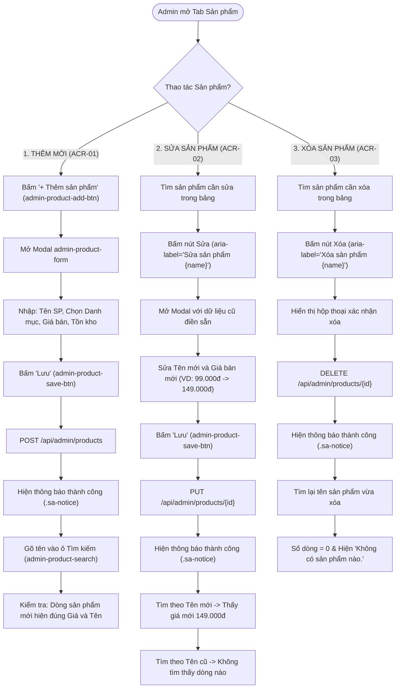
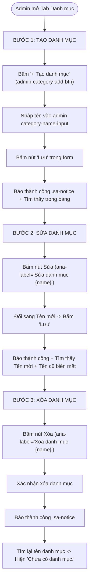
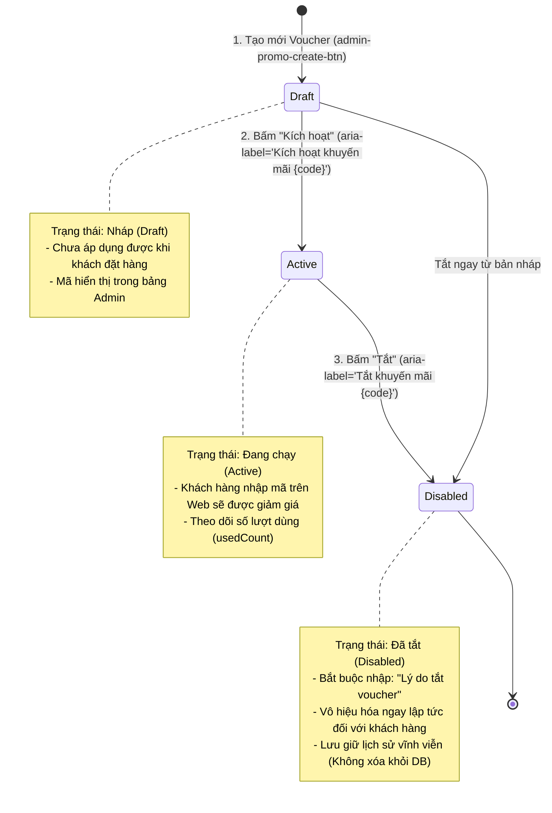
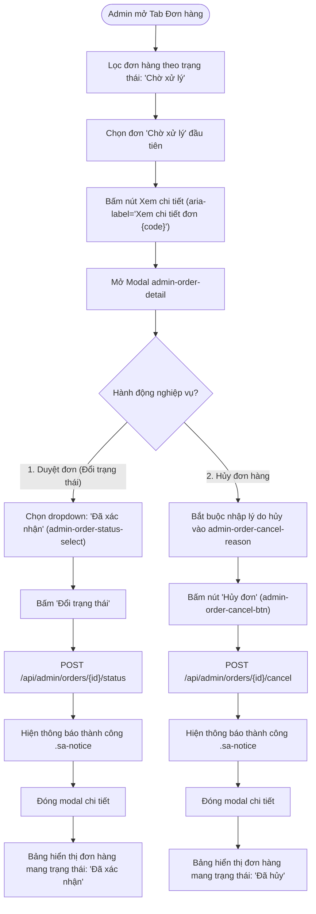
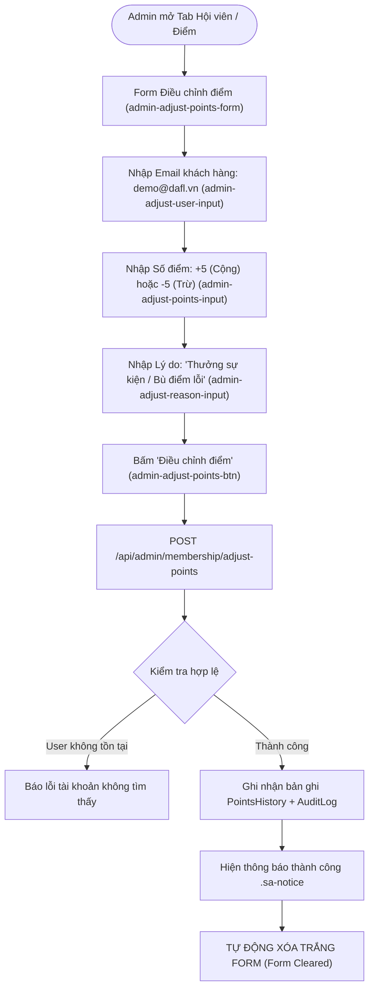

# TÀI LIỆU ĐẶC TẢ THIẾT KẾ GIAO DIỆN (UI/UX) VÀ LUỒNG NGHIỆP VỤ HỆ THỐNG
## Dự Án E-Commerce Mỹ Phẩm DAFL (Storefront :3000 & Admin Portal :3001)

> **Tài liệu chuẩn hóa dành cho:** Đồ án tốt nghiệp & Triển khai Frontend/Backend  
> **Phiên bản:** 2.0 — Bổ sung toàn diện Đặc tả Luồng Nghiệp Vụ Thêm / Sửa / Xóa (CRUD) Chuyên Sâu Admin  
> **Tương thích:** 100% với 130 kịch bản kiểm thử tự động (Selenium POM + Quality Gate)  
> **Vai trò thực hiện:** Lead Business Analyst (BA) & Senior UI/UX Designer  

---

## MỤC LỤC

1. [TỔNG QUAN HỆ THỐNG & ĐỐI TƯỢNG NGƯỜI DÙNG](#1-tong-quan-he-thong--doi-tuong-nguoi-dung)
2. [HỆ THỐNG THIẾT KẾ (DESIGN SYSTEM & TOKENS)](#2-he-thong-thiet-ke-design-system--tokens)
3. [ĐẶC TẢ CHI TIẾT 10 TRANG & LUỒNG WEBSITE KHÁCH HÀNG (:3000)](#3-dac-ta-chi-tiet-10-trang--luong-website-khach-hang-3000)
   - [Trang 1: Trang Chủ (Home & Discovery)](#trang-1-trang-chu-home--discovery)
   - [Trang 2: Trang Danh Mục & Khám Phá (Catalog & Search)](#trang-2-trang-danh-muc--kham-pha-catalog--search)
   - [Trang 3: Trang Chi Tiết Sản Phẩm (Product Detail Page - PDP)](#trang-3-trang-chi-tiet-san-pham-product-detail-page---pdp)
   - [Trang 4: Ngăn Giỏ Hàng Thông Minh (Smart Cart Drawer)](#trang-4-ngan-gio-hang-thong-minh-smart-cart-drawer)
   - [Trang 5: Trang Đặt Hàng & Thanh Toán (One-Page Checkout)](#trang-5-trang-dat-hang--thanh-toan-one-page-checkout)
   - [Trang 6: Cổng Thanh Toán QR PayOS (PayOS Gateway View)](#trang-6-cong-thanh-toan-qr-payos-payos-gateway-view)
   - [Trang 7: Trang Xác Nhận Thanh Toán (Order Success View)](#trang-7-trang-xac-nhan-thanh-toan-order-success-view)
   - [Trang 8: Trang Lịch Sử Đơn Hàng (Customer Orders)](#trang-8-trang-lich-su-don-hang-customer-orders)
   - [Trang 9: Trung Tâm Hội Viên & Hồ Sơ (Profile & Loyalty Hub)](#trang-9-trung-tam-hoi-vien--ho-so-profile--loyalty-hub)
   - [Trang 10: Modal Xác Thực (Auth Modal: Login / Register)](#trang-10-modal-xac-thuc-auth-modal-login--register)
4. [ĐẶC TẢ CHI TIẾT 10 PHÂN HỆ CỔNG QUẢN TRỊ ADMIN (:3001)](#4-dac-ta-chi-tiet-10-phan-he-cong-quan-tri-admin-3001)
   - [Admin 1: Màn Hình Đăng Nhập Quản Trị (Admin Login)](#admin-1-man-hinh-dang-nhap-quan-tri-admin-login)
   - [Admin 2: Bảng Điều Khiển Tổng Quan (Dashboard & Analytics)](#admin-2-bang-dieu-khien-tong-quan-dashboard--analytics)
   - [Admin 3: Quản Lý Đơn Hàng (Order Management & Pipeline)](#admin-3-quan-ly-don-hang-order-management--pipeline)
   - [Admin 4: Drawer & Modal Chi Tiết Đơn Hàng (Order Detail Drawer)](#admin-4-drawer--modal-chi-tiet-don-hang-order-detail-drawer)
   - [Admin 5: Quản Lý Sản Phẩm (Product Catalog Management)](#admin-5-quan-ly-san-pham-product-catalog-management)
   - [Admin 6: Quản Lý Danh Mục (Category Management)](#admin-6-quan-ly-danh-muc-category-management)
   - [Admin 7: Quản Lý Khuyến Mãi & Voucher (Promotions & Coupons)](#admin-7-quan-ly-khuyen-mai--voucher-promotions--coupons)
   - [Admin 8: Quản Lý Khách Hàng (Customer 360 & CRM)](#admin-8-quan-ly-khach-hang-customer-360--crm)
   - [Admin 9: Cấu Hình Hạng Hội Viên (Loyalty Membership Matrix)](#admin-9-cau-hinh-hang-hoi-vien-loyalty-membership-matrix)
   - [Admin 10: Xử Lý Đổi Trả (RMA) & Nhật Ký Kiểm Toán (Audit Logs)](#admin-10-xu-ly-doi-tra-rma--nhat-ky-kiem-toan-audit-logs)
5. [ĐẶC TẢ CHI TIẾT CÁC LUỒNG THÊM - SỬA - XÓA (CRUD) CHUYÊN SÂU ADMIN](#5-dac-ta-chi-tiet-cac-luong-them---sua---xoa-crud-chuyen-sau-admin)
   - [5.1. Triết Lý Thiết Kế CRUD & Ràng Buộc Nghiệp Vụ](#51-triet-ly-thiet-ke-crud--rang-buoc-nghiep-vu)
   - [5.2. CRUD Sản Phẩm (ACR-01, ACR-02, ACR-03)](#52-crud-san-pham-acr-01-acr-02-acr-03)
   - [5.3. CRUD Danh Mục (ACR-04)](#53-crud-danh-muc-acr-04)
   - [5.4. Vòng Đời Khuyến Mãi & Voucher: Draft -> Active -> Disabled (ACR-05)](#54-vong-doi-khuyen-mai--voucher-draft---active---disabled-acr-05)
   - [5.5. Cập Nhật Trạng Thái & Hủy Đơn Hàng (ACR-06, ACR-07)](#55-cap-nhat-trang-thai--huy-don-hang-acr-06-acr-07)
   - [5.6. Điều Chỉnh Điểm Thưởng Hội Viên (ACR-08)](#56-dieu-chinh-diem-thuong-hoi-vien-acr-08)
   - [5.7. Khóa Tài Khoản Khách Hàng & Duyệt Đổi Trả RMA](#57-khoa-tai-khoan-khach-hang--duyet-doi-tra-rma)
6. [MA TRẬN ĐỊNH DANH KIỂM THỬ TỰ ĐỘNG (AUTOMATION SELECTOR MATRIX)](#6-ma-tran-dinh-danh-kiem-thu-tu-dong-automation-selector-matrix)
7. [LỘ TRÌNH TRIỂN KHAI FRONTEND (DEVELOPMENT ROADMAP)](#7-lo-trinh-trien-khai-frontend-development-roadmap)

---

# 1. TỔNG QUAN HỆ THỐNG & ĐỐI TƯỢNG NGƯỜI DÙNG

### 1.1. Bối cảnh dự án
Hệ thống thương mại điện tử **DAFL** là nền tảng bán lẻ mỹ phẩm, chăm sóc da (Skincare) và sắc đẹp chính hãng. Hệ thống tích hợp:
- **Client Web (`localhost:3000`):** Trải nghiệm mua sắm hiện đại, tìm kiếm thông minh, giỏ hàng kéo trượt, thanh toán VietQR tự động qua cổng PayOS, chương trình tích điểm hội viên đa tầng (Loyalty Tier).
- **Admin Portal (`localhost:3001`):** Cổng điều hành nội bộ theo kiến trúc Spark Admin, thực thi máy trạng thái đơn hàng (Order State Machine), kiểm soát tồn kho, thiết lập khuyến mãi và duyệt đổi trả hàng (RMA).
- **Hệ thống Kiểm thử tự động:** Bộ kiểm thử Selenium Page Object Model gồm 130 test case (102 web + 28 admin) gắn liền với Quality Gate trong CI/CD pipeline.

### 1.2. Chân dung người dùng (User Personas)
*   **Persona 1: Khách hàng mua sắm (Shopper):** Cần thông tin bảng thành phần minh bạch, chứng nhận da liễu, theo dõi hành trình đơn hàng và thanh toán nhanh không rườm rà.
*   **Persona 2: Quản trị viên cửa hàng (Store Operator / Super Admin):** Cần xử lý nhanh danh sách đơn chờ duyệt, cập nhật trạng thái đơn hàng chuẩn xác, theo dõi biểu đồ doanh thu theo thời gian thực và quản lý khuyến mãi chống thất thoát ngân sách.

---

# 2. HỆ THỐNG THIẾT KẾ (DESIGN SYSTEM & TOKENS)

### 2.1. Bảng màu (Color Palette Tokens)

```text
[Primary Brand]      #9E2A2B  (Rose Velvet - Tinh tế, sang trọng, thúc đẩy chuyển đổi)
[Secondary Brand]    #2D6A4F  (Botanical Emerald - Đại diện cho mỹ phẩm thiên nhiên, lành tính)
[Accent Gold]        #D4AF37  (Royal Gold - Phù hiệu khách hàng VIP, điểm tích lũy)
[Admin Slate]        #0F172A  (Slate Dark - Sidebar admin chống mỏi mắt)
[Admin Lime Accent]  #B4F105  (Spark Lime - Điểm nhấn biểu đồ doanh thu SVG)
[Surface Light]      #FAF9F6  (Pearl Alabaster - Nền web dịu mắt, tôn hình ảnh sản phẩm)
```

### 2.2. Quy chuẩn Typography
*   **Font chữ nhận diện & Tiêu đề:** `Playfair Display` (Serif quý phái, thanh lịch).
*   **Font chữ giao diện & Nội dung:** `Plus Jakarta Sans` / `Inter` (Sans-serif chuẩn công thái học số).
*   **Thang kích thước:** H1: 36px/700 | H2: 28px/600 | H3: 20px/600 | Body: 15px/400 | Caption: 12px/500.

---

# 3. ĐẶC TẢ CHI TIẾT 10 TRANG & LUỒNG WEBSITE KHÁCH HÀNG (:3000)

*(Xem chi tiết cấu trúc Header, Hero Carousel, PDP, Smart Cart Drawer, PayOS VietQR, Checkout và Loyalty Hub như đã đặc tả ở phiên bản 1.0)*

---

# 4. ĐẶC TẢ CHI TIẾT 10 PHÂN HỆ CỔNG QUẢN TRỊ ADMIN (:3001)

*(Xem chi tiết cấu trúc Dashboard KPI, Data Table Đơn hàng, Quản lý sản phẩm, danh mục, voucher, hội viên, RMA và Audit Logs như đã đặc tả ở phiên bản 1.0)*

---

# 5. ĐẶC TẢ CHI TIẾT CÁC LUỒNG THÊM - SỬA - XÓA (CRUD) CHUYÊN SÂU ADMIN

Dưới góc độ Business Analyst và UI Designer, các thao tác Thêm / Sửa / Xóa trong DAFL Admin không đơn thuần là các lời gọi API thông thường, mà phản ánh tư duy kiến trúc phần mềm và nguyên tắc toàn vẹn dữ liệu trong E-Commerce.

---

### 5.1. Triết Lý Thiết Kế CRUD & Ràng Buộc Nghiệp Vụ

| Đối tượng | Thao tác Hỗ trợ | Thao tác Bị Chặn | Lý do Nghiệp vụ & Kiến trúc |
| :--- | :--- | :--- | :--- |
| **Sản phẩm (Products)** | **Thêm, Sửa (Tên, Giá), Xóa** | Không được sửa Slug của sản phẩm đã phát sinh đơn | Sản phẩm có thể tạo và dọn dẹp linh hoạt. Nếu sản phẩm đã nằm trong đơn hàng lịch sử, DB áp dụng Soft-Delete hoặc ràng buộc khóa ngoại an toàn. |
| **Danh mục (Categories)**| **Thêm, Sửa (Tên), Xóa** | Không xóa danh mục đang chứa sản phẩm | Tránh mồ côi dữ liệu (Orphaned Products). |
| **Khuyến mãi (Promotions)**| **Tạo (Draft) $\rightarrow$ Kích hoạt (Active) $\rightarrow$ Tắt (Disabled)** | **CẤM SỬA & CẤM XÓA** trên giao diện | **Bảo toàn dữ liệu kiểm toán:** Nếu sửa hoặc xóa voucher, các đơn hàng cũ đã áp dụng mã đó sẽ bị sai lệch giá trị lịch sử và báo cáo tài chính. Do đó chỉ cho phép Vô hiệu hóa có kèm lý do. |
| **Đơn hàng (Orders)** | **Đổi trạng thái, Hủy đơn có lý do** | **CẤM XÓA ĐƠN HÀNG** | Đơn hàng là chứng từ thương mại điện tử, tuyệt đối không được xóa khỏi cơ sở dữ liệu. |
| **Điểm hội viên (Points)** | **Cộng / Trừ điểm cân bằng kèm lý do** | **CẤM GHI ĐÈ SỐ DƯ TRỰC TIẾP** | Mọi biến động điểm phải tạo ra một bản ghi giao dịch (Points Transaction) để đối soát. |

---

### 5.2. CRUD Sản Phẩm (ACR-01, ACR-02, ACR-03)

#### A. Sơ đồ Luồng Nghiệp Vụ Thêm / Sửa / Xóa Sản Phẩm


#### B. Đặc tả Giao diện & Thành phần Form Sản phẩm
*   **Trigger thêm:** Nút `+ Thêm sản phẩm` (`[data-testid='admin-product-add-btn']`).
*   **Modal Form (`[data-testid='admin-product-form']`):**
    *   Tên sản phẩm: Ô nhập text (`[data-testid='admin-product-name-input']`), bắt buộc, không trùng lặp.
    *   Danh mục: Dropdown chọn danh mục thật có sẵn (`[data-testid='admin-product-category-select']`).
    *   Giá bán: Ô nhập số nguyên (`[data-testid='admin-product-price-input']`), giá trị $> 0$, hiển thị định dạng `99.000đ`.
    *   Tồn kho ban đầu: Ô nhập số nguyên (`[data-testid='admin-product-stock-input']`), giá trị $\ge 0$.
    *   Nút Lưu: `[data-testid='admin-product-save-btn']`.
*   **Thao tác dòng trên Data Table:**
    *   Nút Sửa: `<button aria-label="Sửa sản phẩm {productName}">✏️</button>`.
    *   Nút Xóa: `<button aria-label="Xóa sản phẩm {productName}">🗑️</button>`.
*   **Thông báo phản hồi (Feedback):**
    *   Banner thông báo xanh lá góc phải phía trên (`.sa-notice`), tự ẩn sau 3 giây.
    *   Khi bảng rỗng: Đoạn text `xpath=//p[contains(text(),'Không có sản phẩm nào.')]`.

---

### 5.3. CRUD Danh Mục (ACR-04)

#### A. Sơ đồ Luồng Nghiệp Vụ Tạo, Sửa, Xóa Danh Mục


#### B. Ràng buộc nghiệp vụ & Selectors
*   **Form thêm/sửa:** `[data-testid='admin-category-form']`.
*   **Trường tên danh mục:** `[data-testid='admin-category-name-input']`.
*   **Nút thao tác dòng:** `//button[@aria-label='Sửa danh mục %s']` và `//button[@aria-label='Xóa danh mục %s']`.
*   **Thông báo bảng rỗng:** `//p[contains(text(),'Chưa có danh mục.')]`.

---

### 5.4. Vòng Đời Khuyến Mãi & Voucher: Draft -> Active -> Disabled (ACR-05)

#### A. Sơ đồ Máy Trạng Thái Voucher Phía Admin


#### B. Bảng Đặc tả Chi tiết Các Bước Vòng Đời Voucher
1.  **Bước 1: Tạo mới Voucher (Draft):**
    *   Bấm `admin-promo-add-btn` $\rightarrow$ Mở modal `admin-promo-form`.
    *   Nhập Mã code (`admin-promo-code-input`, ví dụ `TEST1700000000`). Mã tự động chuyển In hoa, không dấu, không khoảng trắng, độ dài $3 - 50$ ký tự.
    *   Nhập Giá trị giảm (Ví dụ: `10` cho 10%).
    *   Bấm nút `Tạo khuyến mãi`. Backend gán trạng thái mặc định là `Draft`.
2.  **Bước 2: Kích hoạt (Activate):**
    *   Tại dòng voucher, bấm nút: `<button aria-label="Kích hoạt khuyến mãi {code}">Kích hoạt</button>`.
    *   Gửi lệnh: `POST /api/admin/promotions/{id}/activate`.
    *   Badge trạng thái trên bảng chuyển sang xanh lá: `Active`.
3.  **Bước 3: Vô hiệu hóa có lý do (Disable with Reason):**
    *   Tại dòng voucher, bấm nút: `<button aria-label="Tắt khuyến mãi {code}">Tắt</button>`.
    *   Bật popup yêu cầu nhập **Lý do tắt** (`[data-testid='admin-promo-disable-reason']`).
    *   Nhập lý do: *"Tắt bởi Admin / Đã hết ngân sách chiến dịch"*.
    *   Bấm nút `Xác nhận tắt`. Gửi lệnh `POST /api/admin/promotions/{id}/disable`.
    *   Badge trạng thái chuyển sang màu xám: `Disabled`. Mã không còn dùng được ở giỏ hàng.

---

### 5.5. Cập Nhật Trạng Thái & Hủy Đơn Hàng (ACR-06, ACR-07)

#### A. Sơ đồ Luồng Cập Nhật & Hủy Đơn


#### B. Quy tắc nghiệp vụ & Selectors
*   **Nguyên tắc toàn vẹn:** Không có nút xóa đơn hàng.
*   **Dropdown đổi trạng thái (`[data-testid='admin-order-status-select']`):** Chỉ hiển thị các bước chuyển tiếp hợp lệ được cấu hình trong `ALLOWED_NEXT`.
*   **Bắt buộc lý do hủy:** Nếu ô `admin-order-cancel-reason` rỗng, nút `admin-order-cancel-btn` sẽ bị khóa hoặc cảnh báo lỗi.

---

### 5.6. Điều Chỉnh Điểm Thưởng Hội Viên (ACR-08)

#### A. Sơ đồ Luồng Nghiệp Vụ Điều Chỉnh Điểm


#### B. Đặc tả Giao diện Form Điều chỉnh Điểm
*   **Vị trí:** Khối card chuyên dụng nằm trong phân hệ Hội viên (`admin-adjust-points-form`).
*   **Các trường nhập liệu:**
    1.  `admin-adjust-user-input`: Nhập Email hoặc User ID.
    2.  `admin-adjust-points-input`: Nhập số nguyên (chấp nhận cả số âm và số dương).
    3.  `admin-adjust-reason-input`: Bắt buộc nhập lý do phục vụ đối soát.
    4.  `admin-adjust-points-btn`: Nút gửi lệnh.
*   **Hành vi sau khi gửi (Post-action UX):**
    *   Hiển thị thông báo `.sa-notice` màu xanh.
    *   Toàn bộ các ô nhập liệu được **tự động reset về rỗng** (`value = ''`) để ngăn chặn việc người quản trị bấm nhầm lần 2 gây sai lệch điểm.

---

### 5.7. Khóa Tài Khoản Khách Hàng & Duyệt Đổi Trả RMA

#### A. Khóa / Mở khóa Tài khoản (`isLocked`):
*   Khi phát hiện tài khoản spam đơn hoặc có dấu hiệu gian lận voucher, Super Admin bấm nút Toggle `Khóa tài khoản`.
*   Hệ thống chuyển cờ `isLocked = true`. Ngay lập tức JWT token của khách bị thu hồi, phiên đăng nhập bị hủy và chặn đăng nhập mới.

#### B. Quy trình Duyệt Đổi Trả & Hoàn Tiền (RMA):
*   Mở modal chi tiết: `[data-testid='admin-return-detail']`.
*   Xem xét lý do và hình ảnh đính kèm từ khách hàng.
*   **Nếu Duyệt:** Nhập số tiền hoàn trả $\le$ Tổng giá trị đơn hàng $\rightarrow$ Bấm `Chấp thuận` $\rightarrow$ Trạng thái chuyển thành `Approved`, kho tự động cộng lại `availableStock`.
*   **Nếu Từ chối:** Bắt buộc nhập lý do từ chối $\rightarrow$ Bấm `Từ chối` $\rightarrow$ Trạng thái chuyển thành `Rejected`, trạng thái đơn hàng giữ nguyên `Delivered`.

---

# 6. MA TRẬN ĐỊNH DANH KIỂM THỬ TỰ ĐỘNG (AUTOMATION SELECTOR MATRIX)

Bảng tổng hợp bộ định vị kiểm thử CRUD Admin tương thích 100% với file `AdminPageUI.java`:

| Tên Thao Tác CRUD | Test Case | Bộ định vị (Locator) | Mục tiêu kiểm thử |
| :--- | :--- | :--- | :--- |
| **Thông báo thành công**| Chung | `.sa-notice` | Kiểm tra banner xanh xuất hiện sau mỗi thao tác |
| **Thêm Sản phẩm** | ACR-01 | `[data-testid='admin-product-add-btn']` | Mở form thêm sản phẩm mới |
| **Lưu Sản phẩm** | ACR-01/02 | `[data-testid='admin-product-save-btn']` | Nút lưu form thêm/sửa sản phẩm |
| **Sửa Sản phẩm** | ACR-02 | `//button[@aria-label='Sửa sản phẩm %s']` | Nút sửa trên từng dòng sản phẩm |
| **Xóa Sản phẩm** | ACR-03 | `//button[@aria-label='Xóa sản phẩm %s']` | Nút xóa trên từng dòng sản phẩm |
| **Thông báo SP rỗng** | ACR-03 | `//p[contains(text(),'Không có sản phẩm nào.')]`| Báo bảng sản phẩm rỗng sau khi xóa |
| **Thêm Danh mục** | ACR-04 | `[data-testid='admin-category-add-btn']` | Mở form thêm danh mục mới |
| **Lưu Danh mục** | ACR-04 | `//*[@data-testid='admin-category-form']//button[text()='Lưu']` | Lưu form danh mục |
| **Sửa Danh mục** | ACR-04 | `//button[@aria-label='Sửa danh mục %s']` | Nút sửa trên từng dòng danh mục |
| **Xóa Danh mục** | ACR-04 | `//button[@aria-label='Xóa danh mục %s']` | Nút xóa trên từng dòng danh mục |
| **Thông báo DM rỗng** | ACR-04 | `//p[contains(text(),'Chưa có danh mục.')]`| Báo bảng danh mục rỗng sau khi xóa |
| **Tạo Voucher (Draft)**| ACR-05 | `//*[@data-testid='admin-promo-form']//button[text()='Tạo khuyến mãi']` | Tạo voucher ở trạng thái Draft |
| **Kích hoạt Voucher** | ACR-05 | `//button[@aria-label='Kích hoạt khuyến mãi %s']` | Chuyển voucher sang Active |
| **Tắt Voucher (Lý do)**| ACR-05 | `[data-testid='admin-promo-disable-reason']` | Nhập lý do tắt voucher sang Disabled |
| **Xem Chi Tiết Đơn** | ACR-06/07 | `//button[@aria-label='Xem chi tiết đơn %s']` | Mở modal xem đơn hàng |
| **Đổi Trạng Thái Đơn**| ACR-06 | `[data-testid='admin-order-status-select']` | Dropdown chọn trạng thái kế tiếp |
| **Lý do Hủy Đơn** | ACR-07 | `[data-testid='admin-order-cancel-reason']` | Nhập lý do bắt buộc khi hủy đơn |
| **Nút Hủy Đơn** | ACR-07 | `[data-testid='admin-order-cancel-btn']` | Xác nhận hủy đơn hàng |
| **Form Điểm Hội Viên**| ACR-08 | `[data-testid='admin-adjust-points-form']` | Form điều chỉnh điểm thưởng |
| **Nút Điều Chỉnh Điểm**| ACR-08 | `[data-testid='admin-adjust-points-btn']` | Gửi lệnh cộng/trừ điểm |

---

# 7. LỘ TRÌNH TRIỂN KHAI FRONTEND (DEVELOPMENT ROADMAP)

1.  **Bước 1:** Chuẩn hóa CSS Token trong `index.css` và `AdminPage.css` theo bảng mã màu và font chữ đã đặc tả.
2.  **Bước 2:** Refactor lại các component giao diện người dùng trên Web (`:3000`), nâng cấp Header, Product Card và tích hợp thanh tiến độ Freeship vào `CartDrawer.tsx`.
3.  **Bước 3:** Tinh gọn bố cục Admin (`:3001`), làm mới biểu đồ doanh thu SVG và Drawer chi tiết đơn hàng.
4.  **Bước 4:** Chạy kiểm tra toàn bộ 130 kịch bản kiểm thử tự động để bảo đảm Quality Gate tuyệt đối trước khi đóng gói báo cáo đồ án:
    ```bat
    cd automation
    run_test_with_gui.bat
    ```
